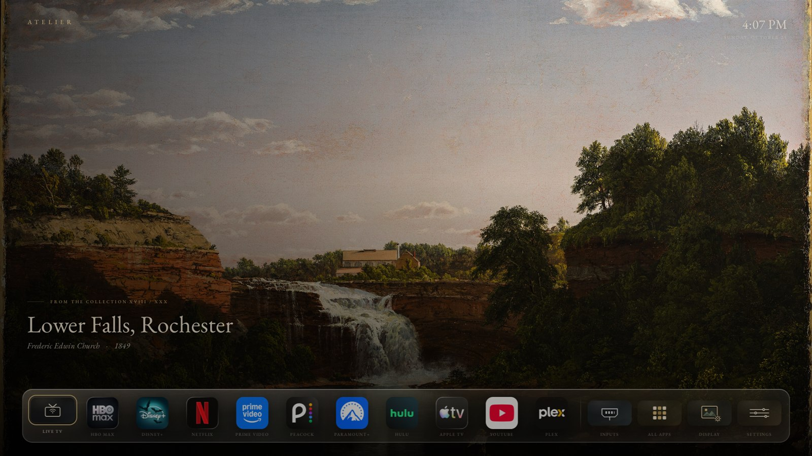

# Atelier — a quiet art gallery for LG TVs

Atelier is a full-screen, ad-free art gallery for **LG webOS TVs**. It shows thirty
authentic public-domain 19th-century American wilderness paintings — Bierstadt,
Moran, Church, Cole, Durand, and the Hudson River School — with a small dock for
the apps already installed on the TV.

It is a normal webOS app. It is **not** a Home-screen replacement, it does not root
your TV, and it does not change any TV settings.



## What it does

- **Thirty 4K paintings**, rotated every 60 seconds with a two-layer dissolve.
- **Clean idle mode** after 45 seconds without input: every icon, label, clock, and
  panel disappears, leaving the painting alone.
- **15-slot dock**: 11 entertainment apps ordered by how often you open them from
  Atelier, a divider, then Inputs, All Apps, Display, and Settings in a fixed group.
- **All Apps**: all 26 curated entries, entertainment in alphabetical order.
- **Gallery controls**: Up enters the gallery; Left/Right change paintings; Down
  returns to the dock; **Up again holds the current painting**, and another Up
  resumes the slideshow.
- **Full Screen** and **Framed** modes, with one seamless white *Modern White*
  frame inspired by Samsung's The Frame bezel.
- **Liquid-glass** dock and panels over live blurred artwork.
- Everything stays on the TV: no accounts, no analytics, no network calls.

## Tested on

| | |
|---|---|
| TV | LG 55NANO75UPA (webOS 6) |
| App surface | 1920×1080 CSS pixels, scaled to the 4K panel |
| App version | 1.3.1 |
| Install method | LG Developer Mode + `ares` CLI sideload |

The UI deliberately avoids CSS features missing from that TV's older Chromium
(no flex `gap`, no `inset`, no `aspect-ratio`), so newer webOS models should run it
too — but this exact build has only been tested on the TV above. App IDs and
layout vary by model, region, and firmware.

## What you need

- An LG webOS TV on the same network as your computer.
- The TV's **Developer Mode** app, with an LG developer account. Enabling it and
  accepting LG's terms is your decision.
- **Node.js 18+** and npm.
- The LG webOS CLI, `@webos-tools/cli`, which provides the `ares` commands.
- A computer on the same LAN. Do not expose the TV to the internet for this.

## Set up the TV

1. Install **Developer Mode** from the LG Content Store if it is not already there.
2. Open it, sign in with your LG developer account, and turn Developer Mode on.
   Make sure the **Key Server** button in Developer Mode is also enabled.
3. Note the TV's **IP address** and the **passphrase** the app displays. Keep the
   passphrase private; it is effectively a temporary SSH credential.
4. Keep the TV powered on and awake while you install. Developer Mode sessions
   expire after a while; renewing is a normal part of sideloading.

## Build and install

### 1. Install the CLI

```powershell
npm install -g @webos-tools/cli
ares --version
```

### 2. Pair the TV

```powershell
ares-setup-device
```

Choose **add**, then enter:

| Prompt | Value |
|---|---|
| Device name | anything, e.g. `mytv` |
| Description | optional |
| Host / IP | the TV's IP address |
| Port | `9922` |
| User | `prisoner` |
| Private key | leave the default |

Then fetch a key, entering the passphrase from Developer Mode when prompted:

```powershell
ares-novacom -d mytv --getkey
```

Check the connection:

```powershell
ares-device -d mytv -i
```

If that returns device information, you are paired. Do not commit or share the
generated key file.

### 3. Fetch the streaming icons

The repository does not redistribute App Store artwork. This script downloads the
sixteen 1024×1024 icons used for the entertainment tiles and verifies each one
against the SHA-256 recorded in `tools/icons.json`:

```powershell
node tools/fetch-icons.js
```

If a URL has gone stale, the build still works but that tile shows a missing icon.
You can drop in your own square PNG with the same filename under
`app/assets/icons/ios/`.

### 4. Package and install

On Windows, the build script fetches the icons, packages the app, and can install
and launch it in one go:

```powershell
powershell -ExecutionPolicy Bypass -File tools\build.ps1 -Device mytv
```

Or do it manually:

```powershell
node tools/fetch-icons.js
ares-package app -o dist
ares-install -d mytv "dist\com.atelier.gallery_1.3.1_all.ipk"
ares-launch  -d mytv com.atelier.gallery
```

Open **Atelier** from the TV's app list; add it to your favorites there if your TV
offers that. Do **not** add a `packageinfo.json` inside `app/` — `ares-package`
generates it.

## Using the remote

| Button | What happens |
|---|---|
| **Up** on the home screen | Start the gallery immediately |
| **Left / Right** on the artwork | Previous / next painting |
| **Enter** on the artwork | Start the gallery |
| **Down** on the home screen | Move focus to the dock |
| **Enter** on the dock | Open that app, or the input list |
| **Arrows** in Display | Choose Full Screen or Framed; Right on Framed opens the finish tile |
| **Enter** in Display | Apply the mode or finish |
| **Up** in the gallery | Hold the painting in view |
| **Up again** in the gallery | Resume the 60-second slideshow |
| **Left / Right** in the gallery | Change paintings without leaving the gallery |
| **Down** in the gallery | Return to the home screen with the dock focused |
| **Another key** in the gallery | Wake the interface and resume rotation |
| **Back** | Close a panel, or step back to the dock |
| **1 9 1 1** | Show a small diagnostics card |
| Leave it alone for 45 seconds | Enter the clean idle gallery |

## Make it yours

Most of the setup lives in **`app/js/config.js`**:

- **`plates`** — the painting list, titles, artists, and years.
- **`rotateSeconds`**, **`crossfadeMs`**, **`idleAfterSeconds`** — timing.
- **`startIndex`**, **`displayDefault`**, **`frameDefault`** — startup state.
- Dock and catalog app IDs — see `APP-IDS.md`. IDs differ between TVs and regions.

After editing, rebuild and reinstall.

## Honest limits

- **This is not a Home replacement.** LG does not allow third-party apps to replace
  the Home screen. Atelier opens like any other app, and its **Restore Stock LG TV**
  button is only a request to open the stock Home — it does not undo anything.
- **Usage ranking only sees launches made inside Atelier.** LG denies third-party
  apps the installed-app list and foreground-app APIs, so apps opened from LG's own
  Home do not move in the dock.
- **App IDs are not universal.** The defaults are common US IDs. If a tile does not
  open, test the ID with `ares-launch -d mytv <id>` and edit `config.js`.
- **Plex is not bundled.** The default Plex tile targets the separately maintained
  unofficial **PlxNative** client (`com.beb.plxnative`), and falls back to `cdp-30`.
  Neither is installed by this repository. Install a Plex client yourself, or point
  the tile at the ID of the Plex app you already have.
- **App Store icons are downloaded, not shipped**, for trademark reasons. They
  identify apps you already own; no affiliation or endorsement is implied.
- **Sideloading means Developer Mode.** It can expire, and renewing it requires the
  TV and your computer. No root, no firmware changes, no app removal.
- **One model tested.** Layout and key handling are expected to work on other webOS
  TVs, but they have not been verified there.

## Privacy

The app makes no network requests, has no account, and sends nothing anywhere.
Display mode, frame finish, the current painting, dock-usage counts, and the
Restore Stock log are kept in the TV's local `localStorage` and are removed when the
app is removed. The only
network activity in this repository is the one-time icon download during the build.

## Uninstall

```powershell
ares-install -r com.atelier.gallery -d mytv
```

That removes Atelier and its local data. Nothing else on the TV is touched. To close
developer access, use the TV's **Developer Mode** app after removing Atelier. Do not
factory reset the TV.

## Credits and license

- **Paintings**: public domain; every work, source scan, and Wikimedia Commons link
  is listed in [`ART-CREDITS.md`](ART-CREDITS.md).
- **Fonts**: EB Garamond, SIL Open Font License 1.1 (`app/fonts/OFL.txt`).
- **webOSTV.js**: Apache License 2.0 (`app/vendor/LICENSE-2.0.txt`).
- **Code**: MIT — see [`LICENSE`](LICENSE).
- **Streaming icons**: not included; fetched locally, and the property of each
  service. The frame finish is an original CSS recreation, not Samsung hardware or
  licensed artwork.

Built for one owner's TV and shared in case it is useful for yours. No warranty; a
sideloaded app is your responsibility on your own TV.
